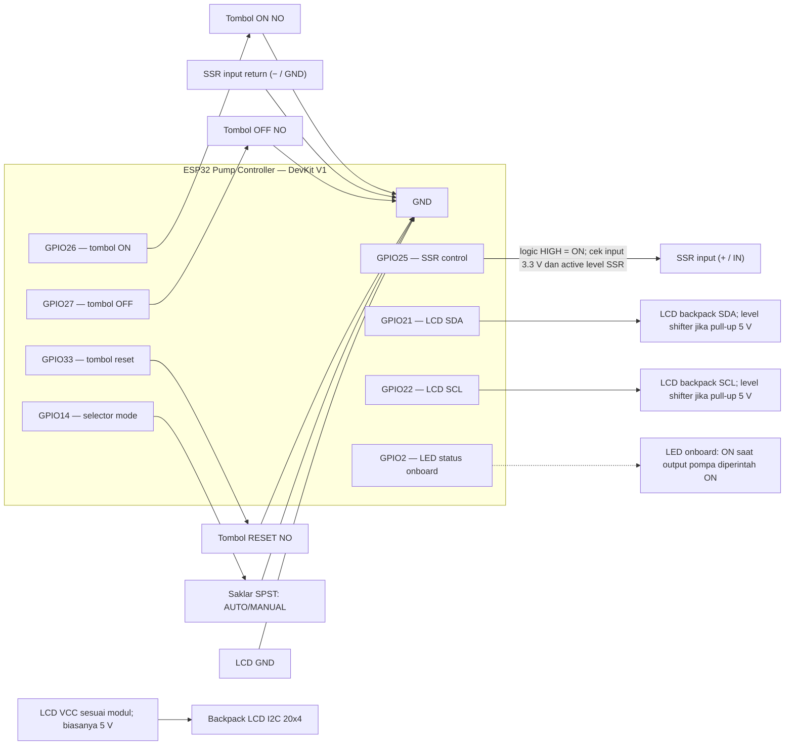
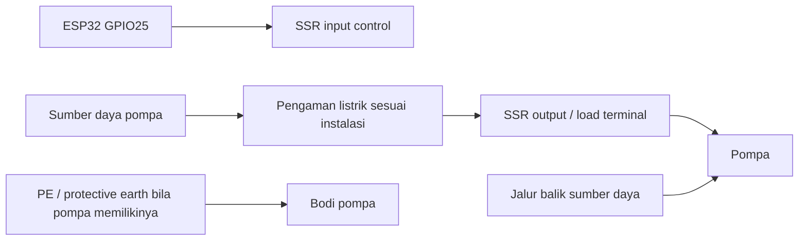
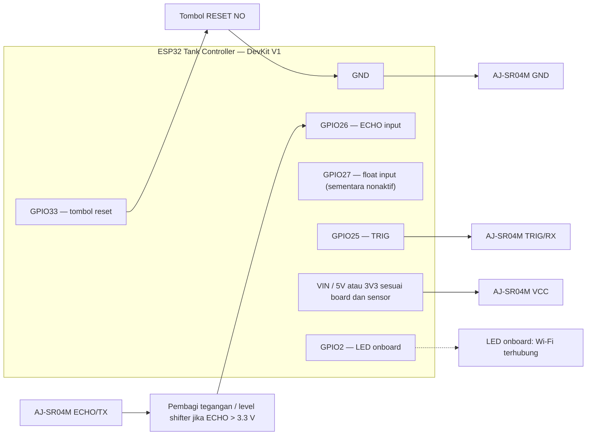
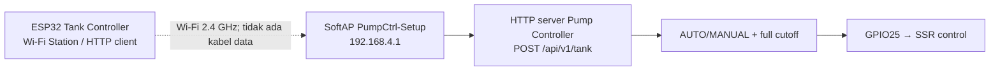

# Diagram Wiring — Water Pump Automation V2.3

Rancangan ini memakai **dua ESP32 DevKit V1 / ESP32-WROOM-32**. Diagram menunjukkan rangkaian kontrol tegangan rendah dan jalur komunikasi. Tidak ada kabel GPIO antara kedua ESP32; data dikirim lewat Wi-Fi SoftAP Pump Controller.

## 1. ESP32 Pump Controller

### Sambungan kontrol Pump Controller

| Pin ESP32 | Sambungan | Arti di firmware |
|---|---|---|
| GPIO25 | Ke input kontrol SSR | HIGH = perintah ON; default OFF saat boot |
| GPIO26 | Tombol ON NO ke GND | Aktif LOW; hanya diterima saat selector MANUAL |
| GPIO27 | Tombol OFF NO ke GND | Aktif LOW; berlaku di AUTO dan MANUAL; menang jika dua tombol bersamaan |
| GPIO33 | Tombol RESET NO ke GND | Aktif LOW; debounce 15 ms; Pump Controller memerintah SSR OFF lalu reboot |
| GPIO14 | Selector SPST ke GND | Terbuka = AUTO; tersambung ke GND = MANUAL |
| GPIO21 | LCD backpack SDA | I²C SDA; level shifter bila pull-up backpack 5 V |
| GPIO22 | LCD backpack SCL | I²C SCL; level shifter bila pull-up backpack 5 V |
| GPIO2 | LED onboard | Indikator keluaran pompa yang diperintah |
| GND | Ground tombol dan logika SSR sesuai manual modul | Jangan sambungkan sisi beban pompa ke ground GPIO |

Input tombol dan selector memakai pull-up internal. Tombol reset adalah tombol NO sesaat, bukan saklar toggle; lepaskan tombol sebelum board dinyalakan agar tidak tertahan. Firmware memerintah SSR OFF sebelum reboot, tetapi tombol ini bukan emergency stop hardware. Jangan beri 5 V ke GPIO. Input SSR harus menerima sinyal 3.3 V dari ESP32 dan arusnya harus sesuai kemampuan GPIO; jika modul memerlukan 5 V atau arus lebih besar, gunakan driver transistor yang sesuai. Periksa apakah modul SSR punya terminal `IN+/IN−`, atau `VCC/GND/IN`, dan ikuti skema pabriknya. Jangan menyatukan ground bila modul mengharuskan isolasi optik.

LCD 20x4 memakai library `hd44780_I2Cexp` dengan deteksi backpack umum. Banyak backpack LCD berdaya 5 V menarik SDA/SCL ke 5 V; ukur level pull-up dan gunakan level shifter I²C dua arah bila perlu agar GPIO ESP32 tidak menerima 5 V.

## 2. Jalur sisi beban SSR dan pompa

Diagram ini hanya menunjukkan prinsip pemutusan satu konduktor oleh SSR. Terminal dan urutan sambungan harus mengikuti tipe SSR serta pompa aktual. SSR AC hanya untuk beban AC; SSR DC hanya untuk beban DC. Nilai tegangan, arus, arus awal motor, heat sink, proteksi arus lebih, dan kebutuhan kontaktor harus dicocokkan dengan nameplate pompa dan datasheet SSR. Protective earth tidak dilewatkan melalui SSR. Sisi listrik PLN jangan dirakit dari diagram generik ini; minta teknisi listrik yang kompeten memeriksa dan memasangnya.

## 3. ESP32 Tank Controller dan sensor

### Sambungan sensor Tank Controller

| ESP32 Tank | Sambungan |
|---|---|
| GPIO25 | AJ-SR04M TRIG/RX |
| GPIO26 | AJ-SR04M ECHO/TX; pasang level shifter/pembagi jika keluarannya 5 V |
| GPIO33 | Tombol RESET NO antara GPIO dan GND; aktif LOW dengan pull-up internal |
| VIN/5V atau 3V3 | VCC sensor sesuai varian dan catu yang tersedia; cek label/datasheet modul |
| GND | GND sensor |
| GPIO27 | Float input belum dipakai; pin dibiarkan tidak terhubung |
| GPIO2 | LED onboard status Wi-Fi |

Float switch belum dipasang dan dinonaktifkan di konfigurasi kedua firmware (`ENABLE_FLOAT_SWITCH=false`, `ENABLE_FLOAT_SWITCH_CUTOFF=false`). Payload sementara selalu `float_full:false`; cutoff penuh hanya memakai ultrasonic valid 100%. Setelah switch dibeli, uji kontaknya dengan multimeter, sambungkan satu kabel ke GPIO27 dan satu ke GND, lalu aktifkan fitur di kedua konfigurasi.

AJ-SR04M mempunyai beberapa mode operasi. Firmware ini memakai mode trigger/echo. Pastikan mode papan sensornya benar. Jarak minimum yang dicantumkan datasheet sekitar 20 cm; hasil pengukuran penuh yang kamu laporkan (sekitar 15–30 cm dari permukaan air) perlu diverifikasi pada posisi pemasangan akhir. GPIO ESP32 bekerja pada domain 3.3 V, jadi jangan sambungkan ECHO 5 V langsung ke GPIO26. [Datasheet ESP32-WROOM-32](https://documentation.espressif.com/esp32-wroom-32_datasheet_en.html), [datasheet AJ-SR04M](https://raw.githubusercontent.com/tomaskovacik/kicad-library/master/library/datasheet/K02-AJ-SR04/AJ-SRO4M-RD.en.pdf).

## 4. Komunikasi antarboard

Kedua board diberi daya masing-masing melalui USB atau catu 5 V yang sesuai. **GND kedua ESP32 tidak perlu disatukan untuk komunikasi Wi-Fi.** Ground Tank disatukan dengan GND sensor di sisi Tank. Ground kontrol Pump disambungkan ke SSR hanya jika skema SSR memerlukannya.

## Pemeriksaan sebelum diberi daya

1. Cocokkan nomor GPIO dengan label pin board dan firmware; GPIO25/26 pada kedua board tidak terhubung satu sama lain.
2. Pastikan tidak ada tegangan 5 V di GPIO ESP32, terutama jalur ECHO ultrasonic.
3. Float switch belum digunakan; jangan pasang kabel di GPIO27 sampai sensor tersedia dan diuji.
4. Uji tombol reset Tank dan pastikan data sensor kembali terkirim setelah boot.
5. Uji tombol reset Pump tanpa beban pompa dan pastikan SSR OFF sebelum board reboot.
6. Lakukan pemeriksaan jalur daya pompa dan SSR berdasarkan nameplate/datasheet oleh teknisi kompeten.
